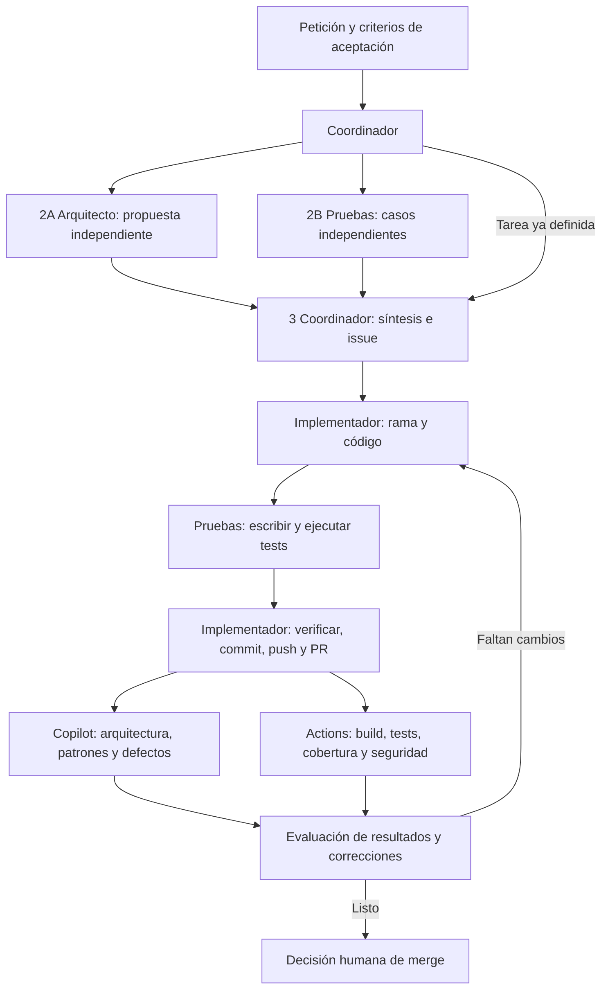

# Flujo de clase con Copilot y GitHub

El Coordinador conserva la síntesis y crea su issue. El Implementador desarrolla en una rama, recibe las pruebas y publica un PR. Copilot revisa el cambio y GitHub Actions ejecuta las comprobaciones. La persona responsable decide el merge. La [configuración de GitHub](github-flow.md) detalla herramientas, checks y permisos.

Las consultas 2A/2B ayudan cuando la tarea necesita diseño; una tarea definida puede ir directamente al Implementador. No son obligatorios expedientes, paquetes congelados ni confirmaciones de guardado. Los expedientes e informes anteriores conservan su valor histórico; sus restricciones antiguas no sustituyen este flujo.

## Roles y archivos

| Rol/fase | Trabajo autorizado | Salida |
|---|---|---|
| Arquitecto 2A | Lee requisitos y código; edita sólo su informe | `docs/informes/<tarea>/2A-arquitectura.md` |
| Pruebas 2B | Deriva casos de requisitos sin ejecutar ni editar tests | `docs/informes/<tarea>/2B-pruebas.md` |
| Coordinador 3 | Compara informes disponibles, guarda síntesis y gestiona un issue por tarea mediante MCP | `3-sintesis.md`, número y URL de issue |
| Implementador | Código y documentación; único responsable de rama, commit, push y PR | Cambio en rama de tarea y `4-entrega.md` |
| Pruebas posterior | Escribe tests/configuración pertinente y ejecuta comprobaciones; no código de producción ni operaciones Git | `4-pruebas.md` y reportes reales |
| Revisor | Lee cambios y evidencia; señala defectos concretos | Hallazgos con ubicación e impacto |
| Copilot en PR / Actions | Revisión y comprobaciones automatizadas, respectivamente | Comentarios, checks y artefactos del PR |

Los informes de la tabla viven en la misma carpeta de tarea. BASE-001 identifica únicamente la base de la clase. Usa otro identificador estable para otra funcionalidad; conserva la relación entre síntesis, issue, rama y PR. Los archivos se guardan al terminar el paso sin pedir otra confirmación; una petición explícita de no hacer cambios prevalece.

## Recorrido en Visual Studio

1. Abre `CursoNETIA.slnx` y comprueba perfiles y MCP según [Harness Copilot](harness-copilot.md). Da al Coordinador el objetivo, alcance y comportamiento esperado. Si el usuario pregunta o pide sólo análisis, el flujo termina en análisis/informe permitido; no publica issues ni PR.
2. Si hacen falta 2A/2B, abre chats separados de Arquitecto y Pruebas con la misma petición y código. No adjuntes al segundo el informe del primero. Cada rol guarda su informe. No necesitan ejecutarse simultáneamente.
3. Vuelve al Coordinador con `sintesis.prompt.md`. Lee los archivos reales, registra acuerdos y diferencias y guarda la síntesis. Crea o actualiza el issue de forma idempotente y guarda su enlace. Si no hay informes, construye la síntesis desde la petición y declara esa fuente. Una recomendación no inventa una decisión del usuario.
4. Pasa al Implementador la síntesis, issue y petición de implementar. Verifica remoto/base, crea o reutiliza una rama `codex/<tarea>-<descripcion>` y escribe el código solicitado. Una tarea directa puede avanzar localmente aunque el issue siga pendiente de coordinación.
5. Al terminar ese turno, cambia al rol Pruebas con `pruebas-implementacion.prompt.md`. Escribe los tests pertinentes y ejecuta tests/arquitectura/cobertura. Si detecta un defecto de producción, devuelve el caso al Implementador. Este puede escribir tests por sí mismo cuando no se usa el rol Pruebas; nunca simula su intervención.
6. El Implementador revisa los cambios de ambos turnos, ejecuta las comprobaciones pertinentes, hace commit/push y crea o actualiza un solo PR con `Closes #<issue>`, evidencia y pendientes. Si fallan o faltan comprobaciones locales necesarias, el PR es borrador. Con las locales aprobadas puede abrirlo listo para revisión para disparar CI/Copilot; declara los controles remotos en curso sin dar por aprobado el merge. Al corregir un borrador y verificarlo, lo convierte a listo y solicita Copilot si hace falta.
7. Copilot y Actions revisan el PR. El Implementador atiende hallazgos confirmados y mantiene el mismo PR. Los checks obligatorios deben aprobar y el humano decide el merge. Abrir un PR no equivale a aceptar el cambio ni cerrar la tarea.

## Escritura y evidencia

Hay un solo escritor técnico a la vez. El cambio manual de rol cede el turno: el Implementador termina sus ediciones antes de que Pruebas empiece, y retoma después de recibir su informe. No se ejecutan chats que modifiquen archivos simultáneamente. Sólo el Implementador publica commits y PR; Pruebas devuelve sus archivos y resultados.

La evidencia distingue resultados observados, hipótesis y verificaciones pendientes. Registra comandos, estado analizado, salidas/resúmenes y ubicación de reportes; enlaza resultados de Actions cuando existan. No copies secretos ni logs completos innecesarios. Conserva los análisis iniciales 2A/2B al registrar evaluación posterior.

Si una herramienta o permiso falta, continúa lo local y explica el pendiente concreto. Una llamada MCP fallida o de resultado incierto nunca acredita que existe un issue o PR: vuelve a consultar antes de reintentar para evitar duplicados. No declares build, cobertura, seguridad o revisión aprobados sin evidencia.

## Alcance de la coordinación

Los perfiles son instrucciones de trabajo, no un orquestador automático. En Visual Studio el alumno selecciona los roles; un archivo `.agent.md` no invoca otro chat. Una eventual adaptación a Copilot CLI requiere comprobar sus herramientas y coordinación por separado; no presupongas delegación real por disponer de perfiles.

Copilot puede detectar problemas y sugerir cambios; las reglas ejecutables están en tests, workflows y reglas del repositorio. Los dos análisis no demuestran corrección por coincidir, y una revisión de IA no sustituye la responsabilidad humana.
